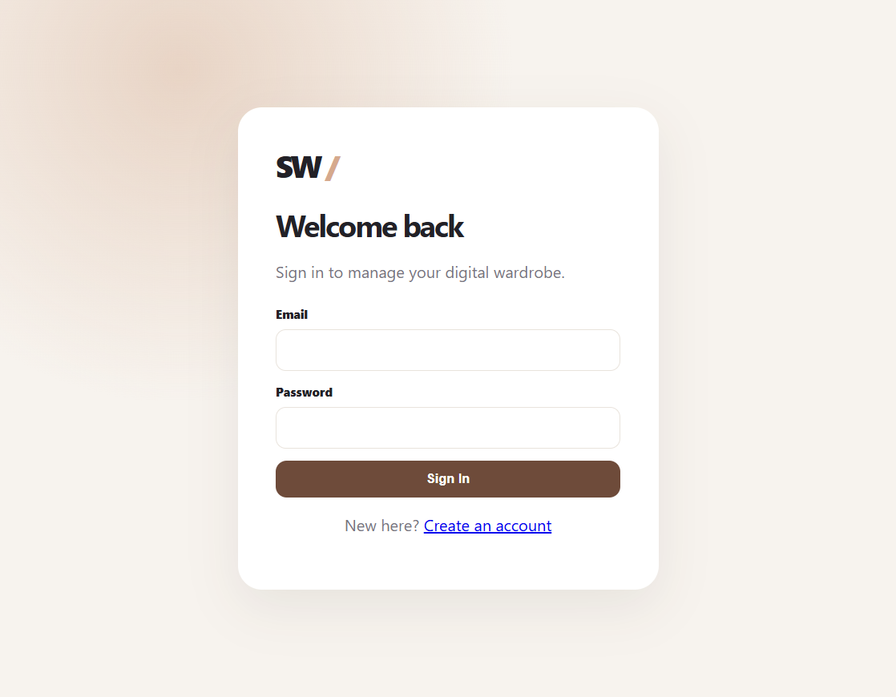
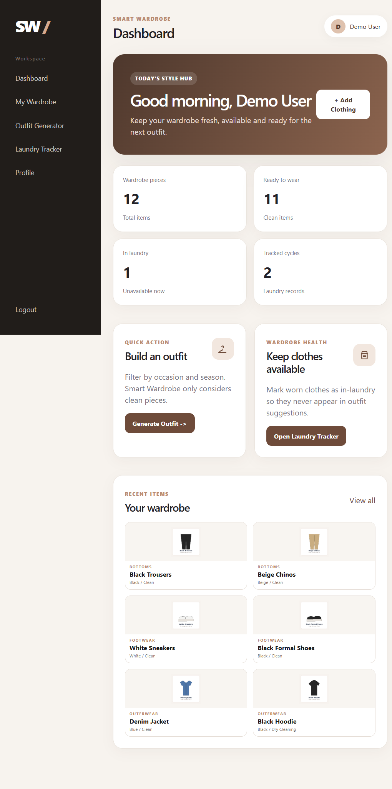
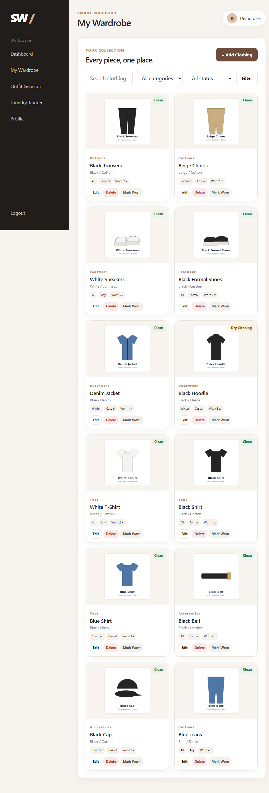
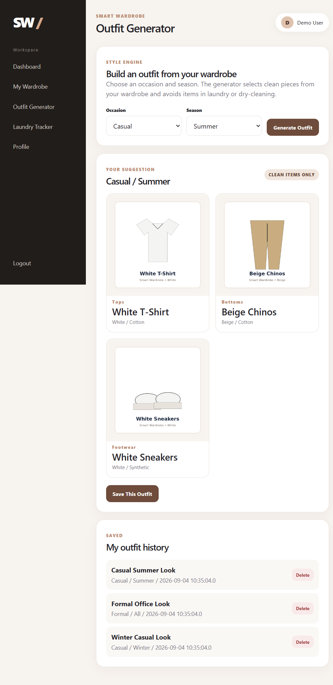
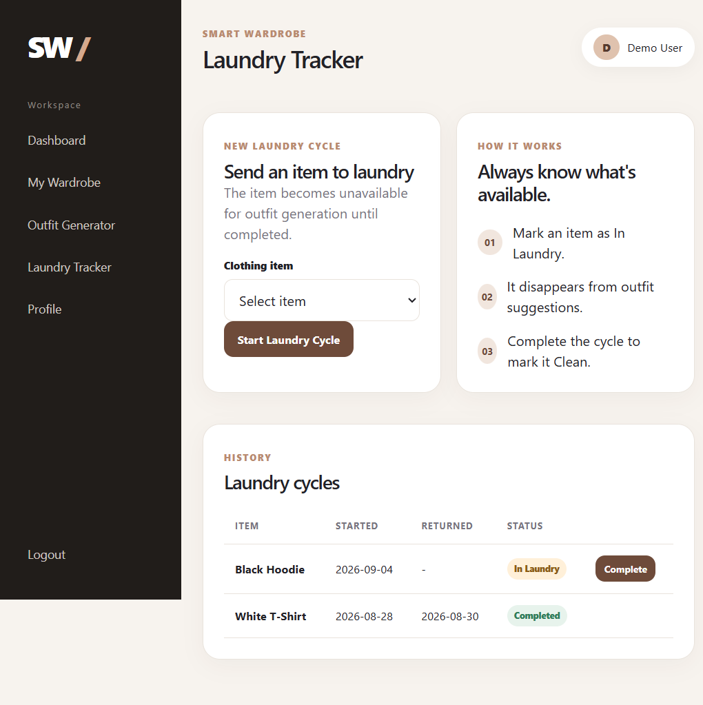
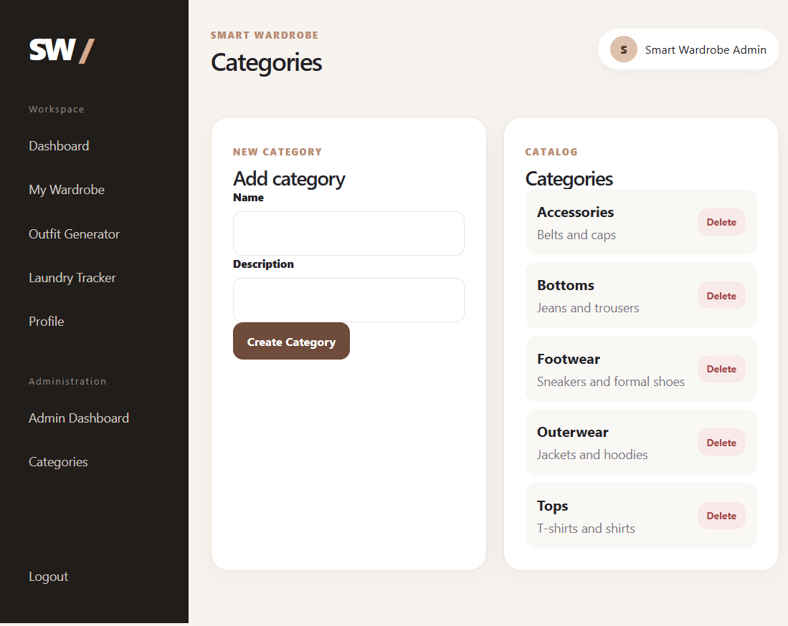

# Smart Wardrobe

Smart Wardrobe is a Java web application for organizing clothing, tracking laundry, and generating outfits from a user's clean wardrobe.

## Technologies

- Java 8-compatible Servlets and JSP
- Apache Tomcat 8.5 (Servlet 3.1)
- MySQL with JDBC and DAO/service layers
- HTML, CSS, JavaScript, and Bootstrap
- Apache Ant / NetBeans

This project currently uses JDBC and Servlet-managed services; it does not yet use Hibernate ORM, Spring Dependency Injection, or JSTL/EL. Its JSPs still contain scriptlets, so those rubric items need implementation before Task 3 is fully complete. Swing is not used because this is a web application.

## Features

- User registration, login, logout, and session-based access
- Wardrobe item create, view, update, and delete operations
- Search/filter, clothing image uploads, laundry tracking, and saved outfits
- Outfit suggestions by occasion and season
- Admin dashboard and category management
- Demo images and sample accounts seeded by the database script

## Requirements

- JDK 8 or later
- Apache Tomcat 8.5 or another Servlet 3.1-compatible Tomcat
- MySQL server
- Apache Ant (or NetBeans with Tomcat configured)

The project is configured for Java 8 bytecode so it can run on a wider range of JDKs and Tomcat installations.

## Database setup

1. Start MySQL (for example, from the XAMPP Control Panel).
2. From the project root, import `database.sql`:

   ```powershell
   cmd /c "C:\xampp\mysql\bin\mysql.exe -u root < database.sql"
   ```

   If your MySQL account has a password, add `-p` and enter it when prompted. The script creates the `smart_wardrobe` database, tables, demo accounts, categories, and sample data. Back up any existing `smart_wardrobe` database before importing; the script updates its seeded demo rows.

3. The app defaults to `localhost:3306`, database `smart_wardrobe`, user `root`, and an empty password. Configure a non-default database using environment variables or JVM system properties:

   | Environment variable | JVM system property | Default |
   | --- | --- | --- |
   | `SMARTWARDROBE_DB_URL` | `smartwardrobe.db.url` | `jdbc:mysql://localhost:3306/smart_wardrobe?useSSL=false&serverTimezone=Asia/Kolkata&allowPublicKeyRetrieval=true` |
   | `SMARTWARDROBE_DB_USER` | `smartwardrobe.db.user` | `root` |
   | `SMARTWARDROBE_DB_PASSWORD` | `smartwardrobe.db.password` | empty |

   Do not commit real database credentials to GitHub.

## Run locally

### NetBeans

1. Open this folder as a NetBeans Web Application project.
2. Configure a JDK and a Servlet 3.1-compatible Tomcat server in NetBeans.
3. Start MySQL and complete the database setup above.
4. Run the project and open `http://localhost:8080/SmartWardrobe/`.

### Apache Ant

With Ant and a JDK on `PATH`, build the deployable WAR:

```powershell
ant -f build.xml dist
```

For a Windows/XAMPP installation, start MySQL and Tomcat in the XAMPP Control Panel, then run from the project folder:

```powershell
ant -f build.xml dist
Copy-Item .\dist\SmartWardrobe.war C:\xampp\tomcat\webapps\SmartWardrobe.war -Force
```

If Tomcat does not reload the WAR automatically, stop and start Tomcat from the Control Panel. Visit `http://localhost:8080/SmartWardrobe/`. Change `C:\xampp\tomcat` in the copy command if Tomcat is installed elsewhere. The project includes the MySQL Connector/J driver in `web\WEB-INF\lib`.

If using XAMPP, start both MySQL and Tomcat from its Control Panel before opening the URL. If either service will not start, run the Control Panel with the permissions required by your installation.

## GitHub and public hosting

GitHub stores the source code but GitHub Pages cannot run Java Servlets/JSP or connect to this MySQL database. A lecturer can clone/download this repository and follow the local run steps above. For a public URL, deploy the WAR to a Java hosting service that supports Tomcat/JVM and configure a reachable MySQL database using the environment variables above. Do not commit database credentials or share them in the repository.

### Public deployment with Railway

The root `Dockerfile` builds the Servlet/JSP application in a Tomcat 9 container and honors Railway's `PORT` setting. Railway's current docs describe deploying from a GitHub repository with a Dockerfile, provisioning a MySQL service, and generating a public HTTPS domain. Review Railway's current pricing before deploying.

1. Push the latest project to GitHub. In Railway, create a project from that GitHub repository; it will detect the root `Dockerfile`.
2. Add a MySQL service to the Railway project. In the app service's **Variables**, add references to the MySQL service (rename the database service to `MySQL` or change the reference names below):

   ```text
   SMARTWARDROBE_DB_URL=jdbc:mysql://${{MySQL.MYSQLHOST}}:${{MySQL.MYSQLPORT}}/smart_wardrobe?useSSL=false&serverTimezone=UTC&allowPublicKeyRetrieval=true
   SMARTWARDROBE_DB_USER=${{MySQL.MYSQLUSER}}
   SMARTWARDROBE_DB_PASSWORD=${{MySQL.MYSQLPASSWORD}}
   ```

3. Import `database.sql` into the hosted MySQL service once. Enable its **TCP Proxy** in Railway settings and use the provided host/port and MySQL credentials from your own account. From Windows Command Prompt in the project folder:

   ```cmd
   C:\xampp\mysql\bin\mysql.exe -h HOST -P PORT -u USER -p < database.sql
   ```

   Replace `HOST`, `PORT`, and `USER` with your database's TCP Proxy values. Keep the password private. Back up any existing database before importing.

4. Wait for the app service deployment to succeed, then open its **Settings → Networking** and choose **Generate Domain**. The evaluation URL will be `https://YOUR-DOMAIN/SmartWardrobe/`.
5. Test login, wardrobe, outfits, and logout using the hosted database. Do not leave the public deployment using the repository's default demo passwords; set new demo credentials and share them with the lecturer only through the submission document, not GitHub.

Railway guides: [deploy from GitHub](https://docs.railway.com/quick-start), [Dockerfiles](https://docs.railway.com/builds/dockerfiles), [MySQL](https://docs.railway.com/databases/mysql), [variables](https://docs.railway.com/variables), and [public domains](https://docs.railway.com/networking/public-networking).

## Demo accounts

- The database seeds `admin@smartwardrobe.com` and `demo@smartwardrobe.com` for local evaluation.
- The repository's earlier history contains the original demo passwords. Reset both hosted account passwords before making the deployment public.

The app's current password hash is SHA-256. After importing the database, run the following against the hosted MySQL database, replacing each placeholder with a different strong password. Share the resulting evaluation credentials with your lecturer privately, not in GitHub:

```sql
UPDATE users SET password = SHA2('REPLACE_WITH_NEW_ADMIN_PASSWORD', 256)
WHERE email = 'admin@smartwardrobe.com';

UPDATE users SET password = SHA2('REPLACE_WITH_NEW_USER_PASSWORD', 256)
WHERE email = 'demo@smartwardrobe.com';
```

## Screenshots

The following screenshots were captured from the running application using demo accounts:








## Source repository and submission status

- GitHub: [keyur-111/SmartWardrobe](https://github.com/keyur-111/SmartWardrobe)
- Public deployed application URL: not configured yet; do not use the local `localhost` URL as a public deployment link.

For the final submission, package the complete source (including `database.sql` and configuration files) as `EnrollmentNo_Name_SourceCode.zip`. Submit a separate PDF named `EnrollmentNo_Name_ProjectDocumentation.pdf` with the project description, technologies, features, screenshots, setup instructions, GitHub link, and a working public deployment URL.
